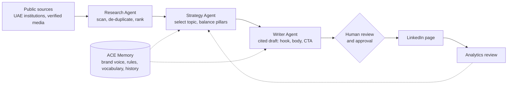

# ACE: Autonomous Content Engine

**An agentic, source-grounded generative AI workflow that turns live UAE financial-technology news into publication-ready LinkedIn content, with a human approving every post.**

Built during a Generative AI & Automation internship at **Resolutions Infotech LLC** (Dubai, UAE), July to October 2026.

---

## Why ACE exists

The UAE financial ecosystem moves fast. Regulators, credit bureaus, banks and fintechs publish something new almost every week, and a small company that wants to be visible to banks and lenders has to keep up, stay accurate and sound like itself. Doing that by hand is slow. Using a general-purpose AI writer is fast, but it can state things that cannot be traced to any source, which is not acceptable in finance.

ACE takes a different route: **research first, write second, cite always, and keep a human in charge.**

## What it does

- **Watches live sources.** Scans public feeds on UAE banking, the Al Etihad Credit Bureau (AECB), fintech, digital government, AI and cybersecurity.
- **Filters the noise.** Removes duplicates and ranks each item for relevance.
- **Picks what to say next.** Chooses the next topic while balancing content pillars.
- **Writes in the company's voice.** Produces LinkedIn drafts with a hook, body and call-to-action, each anchored to a real, linked source.
- **Shows its work.** Every draft carries originality, duplicate-risk and tone indicators, and every source carries a trust tag (official issuer or verified media).
- **Leaves the decision to a person.** Nothing is published without human approval.

## How it works



| Stage | Agent | What it does |
|---|---|---|
| 1 | **Research Agent** | Scans live feeds, removes duplicates, ranks relevance, summarises reports and notices |
| 2 | **Strategy Agent** | Selects the next topic and balances content pillars |
| 3 | **Writer Agent** | Drafts the post from the chosen source in the brand voice |
| 4 | **Human reviewer** | Approves, edits or rejects before publication |

## The application

ACE is a web application with an operator dashboard. The sidebar gives access to:

| Module | Purpose |
|---|---|
| **Dashboard** | Drafts ready, research reports, competitors monitored, upcoming posts, recent activity and agent status |
| **Content Studio** | Enter a topic and generate one or three drafts, each with originality, duplicate and tone scores |
| **Research Hub** | Ranked research items with relevance scores, key figures, a "So what" explanation, a trust tag and a link to the original document |
| **Competitor Intelligence** | Posting frequency, topic distribution, hashtags, posting pattern and content mix for tracked organisations |
| **ACE Memory** | Company profile, brand voice, rules, vocabulary, topics, hooks and history, consulted before every generation |
| **Content Calendar** | Plan and view upcoming posts |
| **Automation** | Live pipeline view with status, run time and output for each agent |
| **Settings** | Application configuration |

LinkedIn is the active channel. X/Twitter and a newsletter are shown as upcoming channels.

## Design principles

1. **Source-grounded.** Every draft links to a real source. No source, no post.
2. **Human in the loop.** The agents propose, a person decides.
3. **Brand-conditioned.** Prompts are shaped by a stored memory of the company's mission, products, audience and voice (short posts, one idea per line, under 90 words, a single open-ended question as the call-to-action).
4. **Structured and validated.** Agents return structured outputs that are validated, and a failed step reports its status instead of breaking the pipeline.
5. **Transparent.** Quality indicators and trust tags are visible, so a reviewer can judge a draft quickly.

## Results so far

From the LinkedIn page analytics export, covering the ten posts published between 14 September and 5 October 2026:

| Metric | Result |
|---|---|
| Posts published | 10 |
| Impressions | 544 (283 unique) |
| Clicks | 22 (click-through rate about 4.0%) |
| Reactions / comments | 9 / 2 |
| Best reach | 168 impressions (credit-data and responsible-financing post) |
| Best engagement | A question-style post, about 26.8% engagement rate |

These numbers are small and should be read as an early signal, not proof of impact. The page started with a very small audience, the sample covers only a few weeks, and the export does not include follower counts.

## Built with

- **Lovable**, an AI-assisted web-app builder, for the full-stack application and dashboard
- A hosted **large language model** accessed through an API, driven by brand-conditioned prompts and structured outputs
- Public feeds and official announcements from UAE institutions and verified media as research input

<!-- TODO (Aditi): name the exact LLM/API, database and hosting you used, and the live demo link. -->

## Getting started

<!-- TODO (Aditi): fill in only what is true for your setup. -->

```bash
# 1. Clone the repository
git clone <repository-url>
cd ace

# 2. Install dependencies
<install command>

# 3. Add your environment variables (LLM API key, data-source settings)
cp .env.example .env

# 4. Run the app
<run command>
```

## Limitations

- Source quality depends on the feeds available, and a reviewer must still check each draft.
- Only LinkedIn is active.
- Results come from a small sample over a short period.

## Roadmap

- [ ] Activate the X/Twitter and newsletter channels
- [ ] Connect to a scheduling and publishing platform so approved posts go out automatically
- [ ] Feed LinkedIn analytics back into the Strategy Agent so topic choice follows measured engagement
- [ ] Run for a longer period to measure follower growth and lead generation

## Related work

The prompt-engineering and robustness questions behind ACE led to two literature studies by the same research team, both submitted in October 2026 and currently under review:

- *Beyond Benchmark Scores: Do LLM-Generated Heuristics Generalize to Unseen Optimization Instances?* (EmergIN 2027)
- *Does Problem Wording Change Solution Quality? Prompt Invariance in LLM-Based Optimization Modelling* (SocProS 2027)

## Author

**Aditi Rathore**, B.Tech Computer Science and Engineering (Artificial Intelligence), Indira Gandhi Delhi Technical University for Women, New Delhi.
GitHub: [AditiR-21](https://github.com/AditiR-21)

## Acknowledgements

Thanks to **Ms. Manisha Singh** and **Resolutions Infotech LLC** for the guidance and the freedom to build this.
